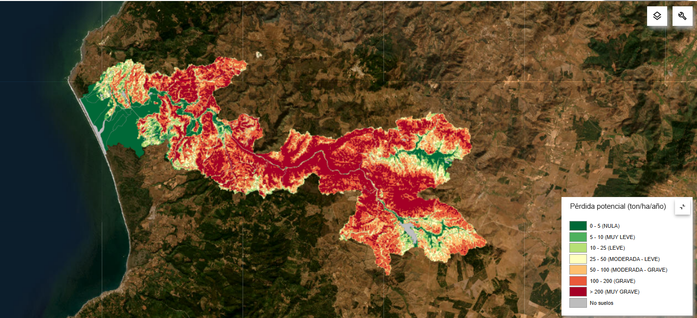
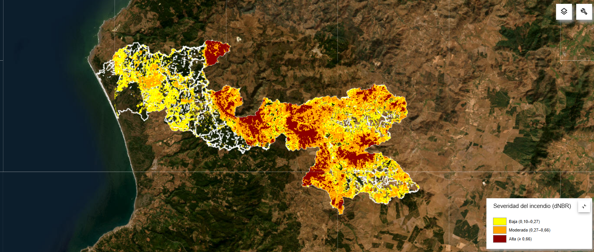
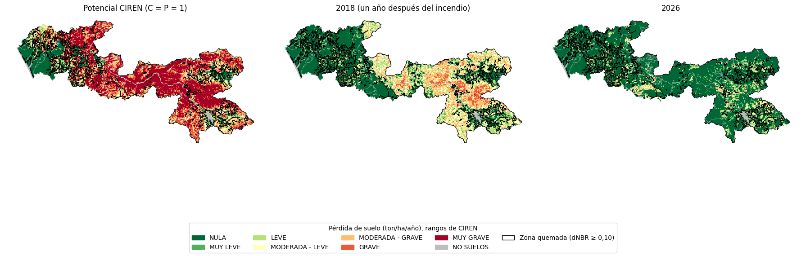

# Erosión post-incendio en la cuenca del río Reloca: aplicación y evaluación del modelo RUSLE

**Curso:** REN235 · **Tarea semestral:** Aplicación y evaluación del modelo RUSLE en cuenca nacional
**Autora:** Sofía Bravo Solsol 
**Plataforma:** Google Earth Engine (notebook Python): [`Cuenca_reloca_incendio.ipynb`](Cuenca_reloca_incendio.ipynb)

---

## Resumen

En enero de 2017, el incendio Las Máquinas quemó cerca de 184 000 ha en la Región del Maule, incluida más de la mitad de la cuenca del río Reloca. Este trabajo evalúa si la pérdida de suelo estimada fue mayor en 2018, un año después del incendio, que en 2026, y si la diferencia es atribuible al fuego. A la pérdida potencial de CIREN (R·K·LS) se le aplicó un factor C derivado del NDVI de Landsat para cada año, con P = 1, y se comparó el cambio en las zonas quemadas (delimitadas con dNBR) con el de las no quemadas. En las zonas quemadas, la pérdida media bajó de 36,1 a 4,8 ton/ha/año, mientras que en las no quemadas pasó de 4,7 a 6,0. El efecto atribuible al incendio fue de 32,6 ton/ha/año, aumentó con la severidad y se mantuvo al considerar la lluvia de cada año. El incendio multiplicó la pérdida estimada en el corto plazo, y la recuperación de la cobertura la devolvió a niveles similares a los de las zonas no quemadas.

---

## 1. Introducción

La erosión hídrica es uno de los principales procesos de degradación del suelo en Chile central, donde se combinan lluvias invernales concentradas, laderas empinadas y una larga historia de uso agrícola y forestal. Los incendios agravan el problema al eliminar la vegetación y la hojarasca, dejando el suelo expuesto a la lluvia, y pueden generar capas hidrofóbicas que aumentan la escorrentía. El efecto es máximo en los primeros años y disminuye a medida que la vegetación se recupera (Shakesby & Doerr, 2006).

El incendio Las Máquinas se inició el 20 de enero de 2017 cerca de Cauquenes y fue controlado el 3 de febrero, tras quemar 183 946 ha (EUCP Team, 2017). Esta cuenca se eligió por ser la del inventario de CIREN más cercana al incendio, que afectó a más de la mitad de su superficie.

Los modelos de erosión suelen agruparse en tres enfoques (Merritt et al., 2003). Los físicos o basados en procesos describen el desprendimiento, transporte y depósito de sedimentos con la ecuación de continuidad de masa; los conceptuales simplifican esos procesos combinando relaciones físicas y empíricas; y los empíricos relacionan estadísticamente la pérdida de suelo con variables observables (Blanco & Lal, 2023; Merritt et al., 2003). No existe un modelo mejor que los demás: su desempeño depende de los datos disponibles, del sitio y de la escala (Blanco & Lal, 2023).

La USLE es el modelo empírico más usado en el mundo. Estima la pérdida media anual de suelo como el producto de la erosividad de la lluvia (R), la erodabilidad del suelo (K), el largo y pendiente de la ladera (LS), la cobertura (C) y las prácticas de conservación (P). Su versión revisada, RUSLE, mantiene esa estructura, mejora el cálculo de cada factor y es hoy el modelo de erosión hídrica más aplicado. Su principal ventaja es la simplicidad: requiere pocos parámetros y se combina fácilmente con SIG y teledetección (Blanco & Lal, 2023).

RUSLE no se basa estrictamente en principios hidráulicos, predice un promedio de largo plazo y no simula cárcavas ni depósito (Blanco & Lal, 2023). Aun así, es defendible aquí por tres razones: sus factores se estiman con datos abiertos; es el modelo del inventario oficial de CIREN, lo que permite comparar con él; y la pregunta es comparativa. Aunque ningún modelo reproduce exactamente las observaciones de terreno, sí entregan información valiosa sobre diferencias relativas en las tasas de erosión (Blanco & Lal, 2023), y al mantener fijos R, K y LS sus errores afectan por igual a ambos años.

**Pregunta:** ¿La pérdida de suelo estimada en la cuenca del río Reloca fue mayor en 2018 que en 2026 como consecuencia del incendio Las Máquinas?

**Hipótesis:** En 2018, la pérdida estimada en las zonas quemadas fue considerablemente mayor que en 2026 por la menor cobertura vegetal (mayor C), mientras que en las zonas no quemadas se mantuvo similar. Por lo tanto, la diferencia entre años se concentra en lo quemado y es atribuible al incendio.

---

## 2. Metodología

### 2.1 Área de estudio

La cuenca del río Reloca (42 988 ha) se ubica en la Cordillera de la Costa de la Región del Maule, en las comunas de Empedrado y Chanco, y desemboca en el humedal de Reloca, Santuario de la Naturaleza. Su clima es templado de tipo mediterráneo, con una precipitación media anual cercana a 840 mm, de régimen pluvial y concentrada en invierno, y una temperatura media de 13 °C (Dirección General de Aguas [DGA], 2014). Como en gran parte de la Cordillera de la Costa entre el Maule y La Araucanía, el bosque nativo fue reemplazado por plantaciones de pino y eucalipto, promovidas en parte para estabilizar suelos severamente erosionados (Oyarzún & Castillo, 2024).

### 2.2 Datos

| Dato | Fuente | Resolución | Uso |
|---|---|---|---|
| Pérdida de suelo potencial (`r07_066_rep_1ha`) | CIREN (2024) | Celdas de 1 ha | Base del modelo (R·K·LS) |
| Landsat 8 y 9, Colección 2, Nivel 2 | USGS (s. f.) | 30 m | Factor C (NDVI) y severidad (dNBR) |
| Área quemada MODIS MCD64A1 | Giglio et al. (2018) | 500 m | Contraste del área quemada |
| Precipitación diaria CHIRPS | Funk et al. (2015) | ~5,5 km | Sensibilidad a R |

El procesamiento se hizo en Google Earth Engine desde Python (`earthengine-api`, `geemap`, `geopandas`), con el script comentado línea por línea.

### 2.3 Etapa 1: pérdida potencial de CIREN

La capa se descargó por WFS desde CIREN en UTM 19S (EPSG:32719), y en GEE se calculó la superficie y el mapa por rango de pérdida, con los rangos y nombres de CIREN (Figura 1).

La capa fija C = P = 1, es decir, un suelo desnudo sin vegetación ni residuos, la condición de referencia con la que se define el factor C (Blanco & Lal, 2023). No representa la erosión actual: es un escenario hipotético que mide la susceptibilidad del terreno, y tampoco equivale a los estados erosivos, que describen erosión ya ocurrida y observada.

### 2.4 Zona quemada y severidad

La severidad se estimó con el dNBR (Key & Benson, 2006): la diferencia del NBR = (NIR − SWIR2)/(NIR + SWIR2) entre compuestos de mediana de Landsat 8 antes (1 dic 2016 – 20 ene 2017; 5 escenas) y después del incendio (10 feb – 1 abr 2017; 5 escenas), con nubes y sombras enmascaradas. Clases: no quemado (< 0,10), baja (0,10–0,27), moderada (0,27–0,66, uniendo las dos moderadas de los autores) y alta (≥ 0,66). MODIS MCD64A1 se usó como contraste.

### 2.5 Etapa 2: modelo modificado (reemplazo de C, con P = 1)

**Qué usó CIREN.** R con datos de la DGA y la DMC; K con su cartografía de suelos del Maule y un muestreo de 2020; LS con LiDAR y ALOS PALSAR; C = P = 1 en la capa potencial (CIREN, 2024).

**Cambio.** Se eligió reemplazar C y P:

> **Aaño = Apotencial × Caño × P**, con P = 1

R, K y LS son los de CIREN y quedan fijos, ya que R representa la erosividad media de largo plazo (Renard et al., 1997). Así, la diferencia entre años se debe solo a la vegetación.

**Factor C.** Se calculó con el NDVI de compuestos de mediana de Landsat 8 y 9 en los veranos 2017-18 (12 escenas) y 2025-26 (26 escenas), entre el 1 de diciembre y el 1 de abril; usar la misma estación evita confundir la recuperación con la fenología. Se usó la ecuación de Van der Knijff et al. (2000):

> **C = exp[ −α · NDVI / (β − NDVI) ]**, con α = 2 y β = 1

Se descartó la de De Jong (1994), C = 0,431 − 0,805 · NDVI, porque da C ≤ 0 para NDVI > 0,535: en una prueba con datos de 2023-24 (NDVI medio 0,67), el C medio fue 0,019, lo que anulaba la pérdida en gran parte de la cuenca.

**P = 1.** No existe un catastro de prácticas de conservación para la cuenca, y CIREN también usa P = 1.

**Dominio de validez.** C se acotó a [0, 1], lo que afecta sobre todo a cuerpos de agua (NDVI < 0); se excluyeron las celdas "No suelos" y los píxeles con nubes. C y dNBR se promediaron dentro de cada celda de 1 ha de CIREN, y el resultado se clasificó con sus rangos.

### 2.6 Etapa 3: comparación

Para cada zona y clase de severidad se calculó la pérdida media ponderada por superficie y el cambio Δ = A₂₀₁₈ − A₂₀₂₆. Como las zonas quemada y no quemada difieren en relieve, suelo y lluvia, se comparan sus cambios y no sus valores:

> **Efecto del incendio = Δquemado − Δno quemado**

Restar lo no quemado descuenta lo que habría cambiado igualmente en toda la cuenca (clima del verano, sensor). También se calcularon las transiciones de clase, el cambio dentro de cada clase potencial y la superficie sobre dos umbrales de tolerancia de distinto origen: 11,2 t/ha/año (Wischmeier & Smith, 1978) y 1,4 t/ha/año (Verheijen et al., 2009).

**Sensibilidad a R.** La potencial se ajustó por la anomalía de lluvia de cada año hidrológico (CHIRPS): factor_R = (P_año / P_1991-2020)^1,534, derivado de R = 0,028·P^1,534 (Bonilla & Vidal, 2011). Como la ecuación se ajustó con lluvia media anual, aplicarla a un año suelto sale de su dominio; por eso es solo un análisis de sensibilidad.

---

## 3. Resultados

### 3.1 Pérdida potencial de CIREN (Etapa 1)

El 51,4 % de la cuenca se clasifica como Grave o Muy grave (> 100 ton/ha/año) bajo la condición de suelo desnudo (Tabla 1, Figura 1). No es la pérdida actual, sino la que habría sin vegetación: la cuenca es muy vulnerable a perder su cobertura.

**Tabla 1.** Superficie por clase de pérdida potencial (CIREN, 2024).

| Rango (ton/ha/año) | Clase | Superficie (ha) | % |
|---|---|---:|---:|
| 0 - 5 | Nula | 4 922,4 | 11,5 |
| 5 - 10 | Muy leve | 1 165,1 | 2,7 |
| 10 - 25 | Leve | 2 535,5 | 5,9 |
| 25 - 50 | Moderada - leve | 3 951,2 | 9,2 |
| 50 - 100 | Moderada - grave | 7 299,8 | 17,0 |
| 100 - 200 | Grave | 11 853,6 | 27,6 |
| > 200 | Muy grave | 10 229,3 | 23,8 |
| — | No suelos | 1 031,4 | 2,4 |
| | **Total** | **42 988,1** | **100,0** |

### 3.2 Zona quemada y severidad

Según el dNBR, 27 551 ha (64,3 %) presentaron señal de quemado; MODIS registró 23 987 ha (55,8 %). La diferencia es esperable: con 30 m, el dNBR detecta manchas y bordes que MODIS (500 m) no resuelve. Lo quemado se concentra en la mitad oriental de la cuenca; el sector costero quedó casi intacto (Figura 2).

**Tabla 2.** Superficie por clase de severidad (dNBR).

| Severidad | Superficie (ha) | % |
|---|---:|---:|
| No quemado | 15 320 | 35,7 |
| Baja | 9 945 | 23,2 |
| Moderada | 11 483 | 26,8 |
| Alta | 6 122 | 14,3 |

### 3.3 Factor C en 2018 y 2026

El NDVI medio de la cuenca subió de 0,52 (verano 2017-18) a 0,68 (verano 2025-26), y el C medio bajó de 0,195 a 0,076. El cambio se concentró en la zona quemada, donde C bajó de 0,250 a 0,063, mientras que en la no quemada se mantuvo estable (de 0,082 a 0,090). La mayor caída se dio en las zonas de severidad alta (de 0,258 a 0,012), que en 2026 presentan el C más bajo de la cuenca.

### 3.4 Pérdida de suelo en 2018 y 2026 (Etapa 3)

**Tabla 3.** Pérdida media (ton/ha/año) por zona y por severidad.

| Zona / severidad | ha | A potencial | A 2018 | A 2026 | Δ (2018 − 2026) | Δ % |
|---|---:|---:|---:|---:|---:|---:|
| No quemado | 14 226 | 100,4 | 4,7 | 6,0 | −1,3 | −27,9 |
| Quemado | 27 730 | 145,9 | 36,1 | 4,8 | 31,3 | 86,6 |
| · Severidad baja | 10 203 | 86,1 | 16,2 | 6,4 | 9,9 | 60,8 |
| · Severidad moderada | 11 689 | 158,1 | 43,8 | 4,8 | 38,9 | 89,0 |
| · Severidad alta | 5 838 | 226,2 | 55,5 | 2,2 | 53,4 | 96,1 |

**Efecto atribuible al incendio:** 32,6 ton/ha/año.

En 2018, la pérdida media en la zona quemada (36,1 ton/ha/año) era casi ocho veces la de la no quemada (4,7); en 2026 ambas son similares (4,8 y 6,0). La zona quemada redujo su pérdida en 31,3 ton/ha/año y la no quemada la aumentó en 1,3, lo que da un efecto de 32,6 ton/ha/año. El efecto crece con la severidad (61 %, 89 % y 96 % de reducción en severidad baja, moderada y alta), un gradiente consistente con una señal territorial del incendio.

El cambio de clase confirma este patrón: en la zona quemada, el 69,9 % de la superficie bajó al menos una clase de CIREN, frente al 11,7 % en la no quemada. En 2018, la zona quemada tenía 7 603 ha en clases Moderada - grave o superiores (129 ha en la no quemada); en 2026, el 74 % de ellas había pasado a la clase Nula.

Como las zonas de mayor severidad coinciden con terrenos de mayor pérdida potencial (226 frente a 86 ton/ha/año), se comparó el cambio dentro de cada clase potencial (Tabla 4).

**Tabla 4.** Cambio en la pérdida media (Δ = A 2018 − A 2026, ton/ha/año) por clase de pérdida potencial.

| Clase potencial | Δ no quemado | Δ quemado |
|---|---:|---:|
| Nula | 0,0 | 0,0 |
| Muy leve | 0,0 | 0,2 |
| Leve | 0,3 | 1,2 |
| Moderada - leve | 0,5 | 4,9 |
| Moderada - grave | 0,1 | 14,3 |
| Grave | −1,1 | 23,6 |
| Muy grave | −4,2 | 58,1 |

En todas las clases el cambio en la zona quemada supera al de la no quemada, por lo que el efecto no se explica solo por el relieve. La diferencia se concentra en los terrenos más susceptibles: en la clase Muy grave, que reúne el 41 % de la superficie quemada, la pérdida bajó de 64,3 a 6,2 ton/ha/año en lo quemado y subió de 5,4 a 9,7 en lo no quemado. En 2026, dentro de una misma clase, la zona quemada pierde igual o menos que la no quemada, lo que sugiere una cobertura densa, probablemente plantaciones replantadas o regeneradas después del incendio (Figura 3).

### 3.5 Umbrales de tolerancia

**Tabla 5.** Porcentaje de cada zona que supera el umbral.

| Umbral | Zona | Potencial | 2018 | 2026 |
|---|---|---:|---:|---:|
| 11,2 t/ha/año (Wischmeier & Smith, 1978) | No quemado | 74,4 | 13,7 | 16,9 |
| | Quemado | 88,1 | 69,0 | 12,8 |
| 1,4 t/ha/año (Verheijen et al., 2009) | No quemado | 83,4 | 34,8 | 39,0 |
| | Quemado | 97,0 | 88,4 | 41,6 |

El umbral de 11,2 t/ha/año es agronómico (mantener la productividad) y el de 1,4 t/ha/año es de sostenibilidad (no perder más de lo que el suelo forma). En 2018 la zona quemada superaba ampliamente ambos, pero la conclusión para 2026 depende del criterio. Con 11,2 t/ha/año, la superficie quemada sobre el umbral bajó de 19 133 a 3 552 ha (12,8 %), por debajo de la no quemada: el problema post-incendio estaría resuelto. Con 1,4 t/ha/año, cerca del 40 % de toda la cuenca sigue sobre el límite (41,6 % quemado y 39,0 % no quemado): la erosión sería un problema de la cuenca completa, independiente del incendio.

### 3.6 Sensibilidad a la lluvia

Respecto de la media 1991-2020 (763 mm), el año hidrológico 2017-18 fue algo seco (686 mm; factor_R = 0,85) y el 2025-26 muy seco (502 mm; factor_R = 0,53). Con la erosividad de cada año, la pérdida en la zona quemada pasa de 30,7 a 2,5 ton/ha/año, y en la no quemada de 4,0 a 3,1. El efecto del incendio baja de 32,6 a 27,3 ton/ha/año, pero mantiene su signo y orden de magnitud: la conclusión es robusta frente a la variabilidad de la lluvia.

### 3.7 Límites del modelo

- **Cárcavas y flujos de barro.** RUSLE no los modela, y tras un incendio suelen aportar más sedimento que la erosión laminar (Shakesby & Doerr, 2006). La pérdida real de 2017-2018 en lo quemado fue probablemente mayor que la estimada.
- **Hidrofobicidad y pérdida de materia orgánica.** Equivalen a un aumento transitorio de K que el modelo no representa. El efecto estimado es, por lo tanto, un límite inferior.
- **El primer invierno.** El período más crítico fue el invierno de 2017, que el modelo de 2018 no captura porque ya había rebrote.
- **C como proxy.** El NDVI no distingue pradera densa de bosque, y la cosecha y replantación forestal cambian C por razones ajenas al incendio.
- **Depósito.** RUSLE no estima el sedimento que llega al humedal de Reloca.

---

## 4. Conclusiones

1. La cuenca es muy vulnerable a la pérdida de cobertura: el 51 % de su superficie tiene pérdida potencial Grave o Muy grave.
2. El incendio afectó al 64 % de la cuenca, concentrado en la mitad oriental y en sus terrenos más susceptibles.
3. Se acepta la hipótesis: en 2018 la pérdida en lo quemado fue casi ocho veces la de lo no quemado, y en 2026 ambas son similares. El efecto atribuible al incendio (32,6 ton/ha/año) creció con la severidad, se mantuvo al comparar terrenos de igual susceptibilidad y resistió la variabilidad de la lluvia (27,3 ton/ha/año).
4. El diagnóstico actual depende del umbral: con 11,2 t/ha/año la zona quemada está recuperada, pero con 1,4 t/ha/año cerca del 40 % de la cuenca sigue sobre el límite, independiente del incendio.
5. La recuperación de C probablemente refleja plantaciones forestales y no vegetación nativa, y por los procesos que RUSLE omite el efecto estimado es un límite inferior de la erosión post-incendio.

---

## Referencias

Blanco, H., & Lal, R. (2023). *Soil conservation and management* (2nd ed.). Springer. https://doi.org/10.1007/978-3-031-30341-8

Bonilla, C. A., & Vidal, K. L. (2011). Rainfall erosivity in Central Chile. *Journal of Hydrology, 410*(1–2), 126–133. https://doi.org/10.1016/j.jhydrol.2011.09.022

CIREN. (2024). *Cuenca Río Reloca. Estimación de la pérdida de suelos potencial (ton/ha/año) escalado a 1 ha* [Capa vectorial]. Inventario de Erosión de Suelos. https://inventarioerosion.ciren.cl/layers/geonode_data:geonode:r07_066_rep_1ha

De Jong, S. M. (1994). Derivation of vegetative variables from a Landsat TM image for modelling soil erosion. *Earth Surface Processes and Landforms, 19*(2), 165–178.

Dirección General de Aguas. (2014). *Inventario de cuencas, subcuencas y subsubcuencas de Chile* (SDT N.° 364). Ministerio de Obras Públicas.

EUCP Team. (2017). *Situación de incendios forestales en Chile entre enero-febrero 2017* [Informe técnico]. Mecanismo de Protección Civil de la Unión Europea. https://www.miteco.gob.es/content/dam/miteco/es/biodiversidad/temas/incendios-forestales/informe_tecnico_if_chile2017_tcm30-425304.pdf

Funk, C., Peterson, P., Landsfeld, M., Pedreros, D., Verdin, J., Shukla, S., Husak, G., Rowland, J., Harrison, L., Hoell, A., & Michaelsen, J. (2015). The climate hazards infrared precipitation with stations—a new environmental record for monitoring extremes. *Scientific Data, 2*, 150066. https://doi.org/10.1038/sdata.2015.66

Giglio, L., Boschetti, L., Roy, D. P., Humber, M. L., & Justice, C. O. (2018). The Collection 6 MODIS burned area mapping algorithm and product. *Remote Sensing of Environment, 217*, 72–85. https://doi.org/10.1016/j.rse.2018.08.005

Key, C. H., & Benson, N. C. (2006). Landscape assessment (LA): Sampling and analysis methods. En D. C. Lutes et al. (Eds.), *FIREMON: Fire effects monitoring and inventory system* (Gen. Tech. Rep. RMRS-GTR-164-CD, pp. LA-1–LA-55). USDA Forest Service, Rocky Mountain Research Station.

Merritt, W. S., Letcher, R. A., & Jakeman, A. J. (2003). A review of erosion and sediment transport models. *Environmental Modelling & Software, 18*(8–9), 761–799. https://doi.org/10.1016/S1364-8152(03)00078-1

Oyarzún, C., & Castillo, Y. (2024). Efectos de las plantaciones forestales sobre la exportación de nutrientes, erosión del suelo, transporte de sedimentos y macroinvertebrados en el centro-sur de Chile: una revisión. *Bosque, 45*(1), 3–15. https://doi.org/10.4067/S0717-92002024000100003

Renard, K. G., Foster, G. R., Weesies, G. A., McCool, D. K., & Yoder, D. C. (1997). *Predicting soil erosion by water: A guide to conservation planning with the Revised Universal Soil Loss Equation (RUSLE)* (Agriculture Handbook No. 703). USDA.

Shakesby, R. A., & Doerr, S. H. (2006). Wildfire as a hydrological and geomorphological agent. *Earth-Science Reviews, 74*(3–4), 269–307. https://doi.org/10.1016/j.earscirev.2005.10.006

U.S. Geological Survey. (s. f.). *Landsat 8-9 Collection 2 Level-2 Science Products*. https://www.usgs.gov/landsat-missions/landsat-collection-2-level-2-science-products

Van der Knijff, J. M., Jones, R. J. A., & Montanarella, L. (2000). *Soil erosion risk assessment in Europe* (EUR 19044 EN). European Soil Bureau, Joint Research Centre.

Verheijen, F. G. A., Jones, R. J. A., Rickson, R. J., & Smith, C. J. (2009). Tolerable versus actual soil erosion rates in Europe. *Earth-Science Reviews, 94*(1–4), 23–38. https://doi.org/10.1016/j.earscirev.2009.02.003

Wischmeier, W. H., & Smith, D. D. (1978). *Predicting rainfall erosion losses: A guide to conservation planning* (Agriculture Handbook No. 537). USDA.

---

## Anexos

### A. Contenido del repositorio

| Archivo | Contenido |
|---|---|
| `Cuenca_reloca_incendio.ipynb` | Script en GEE (Python) |
| `figuras/` | Mapas y figuras del informe |

### B. Reproducibilidad

1. Crear un proyecto en Google Cloud con la API de Earth Engine habilitada y registrarlo para uso no comercial (pasos en el notebook).
2. Cambiar `GEE_PROJECT` en la celda de autenticación por el ID del proyecto propio.
3. Instalar las dependencias: `pip install earthengine-api geemap geopandas matplotlib`.
4. Ejecutar todas las celdas en orden (*Run All*). La descarga de rásteres y el cruce con las celdas pueden tardar varios minutos.

### C. Declaración de uso de inteligencia artificial

En este trabajo se utilizó Claude (Anthropic) como asistente. Se usó para ordenar y comentar el código del notebook, desarrollar las celdas de análisis en Google Earth Engine (severidad con dNBR, factor C para 2018 y 2026, comparación entre zonas y sensibilidad a la lluvia), discutir decisiones metodológicas, buscar referencias y apoyar la redacción y edición del informe. La elección de la cuenca, el enfoque de la hipótesis en el efecto del incendio Las Máquinas, la ejecución del código, la revisión de los resultados y la selección final de fuentes, fueron realizadas por la autora. Las cifras reportadas provienen de la ejecución propia del notebook, y las referencias fueron revisadas por la autora.
